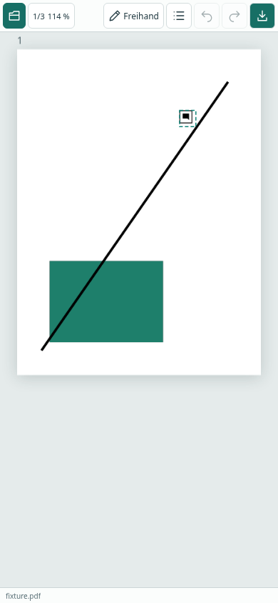
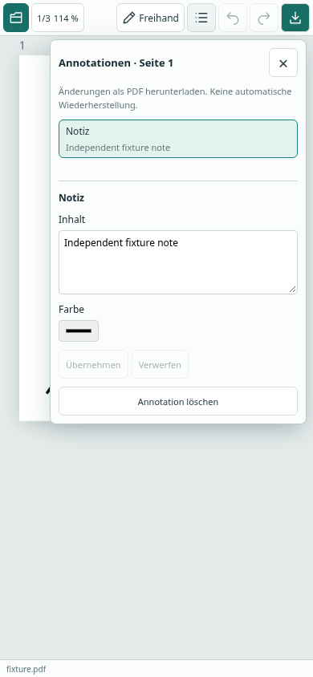

# Kompakte Oberfläche

Die bisher umgebrochenen Werkzeugleisten und die dauerhaft sichtbare Annotationsliste werden durch eine einzelne Hauptleiste ersetzt. Ansicht/Navigation, Werkzeugparameter und Annotationen öffnen sich erst über ihre Schaltflächen. Native Popover-Menüs überlagern das Dokument, ohne die Arbeitsfläche zu verkleinern oder die PDF-Transformation zu ändern. Es ist jeweils nur ein Menü offen.

Öffnen, Rückgängig/Wiederholen und PDF-Download bleiben direkt erreichbar. Das aktive Werkzeug, Seitenzahl und Zoom stehen in der Hauptleiste. Die Statuszeile zeigt Dateiname und ungesicherte Änderungen; zusätzliche Dokumentinformationen erscheinen auf größeren Bildschirmen. Die Quellcode-/Lizenzverknüpfung liegt im Ansichtsmenü.

Schaltflächen sind 36 CSS-Pixel hoch, Menüschriften überwiegend 12 Pixel. Die Hauptleiste benötigt auf dem Handy 45 Pixel, die Statuszeile 22 Pixel. Bei 390 × 844 Pixeln stehen somit 777 Pixel (92,1 %) als PDF-Arbeitsfläche zur Verfügung. Das bezieht sich auf den Browser-Inhaltsbereich; Browser-Adressleiste und Betriebssystemleisten liegen außerhalb.

## Screenshots

Ausschließlich synthetische Test-PDF, keine privaten Dokumente.

| Menüs geschlossen | Annotationsliste auf Abruf |
| --- | --- |
|  |  |

## Prüfung in Codex Cloud

- TypeScript und ESLint: bestanden.
- Vitest: 22 Tests bestanden.
- Chromium: 13 Browser-Tests bestanden; einschließlich echter PDF-Pixel, nativer Annotationen/Export, Undo/Redo, Maus-Zoom/Pan und Touch-Pinch.
- Neue Layouttests bei 320 × 568, 390 × 844, 844 × 390 und 1440 × 900: über 80 % Arbeitsfläche, einzeilige Hauptleiste, kein horizontaler Dokumentüberlauf, geschlossene Menüs beim Start, unveränderte PDF-Transformation beim Öffnen.
- Eigenschaftenentwurf bleibt nach Schließen/Wiederöffnen erhalten; Escape schließt das Menü und gibt den Fokus zurück; beim Menüwechsel wird das vorige Menü geschlossen.
- Ein Klick außerhalb schließt das Menü, ohne gleichzeitig eine Notiz auf der PDF zu platzieren. Der nächste bewusste Klick platziert sie.
- Firefox-Installation in dieser Codex-Umgebung durch die Netzwerkregel mit HTTP 403 „Domain forbidden“ blockiert. Die fünf Layouttests laufen zusätzlich in GitHub Actions mit Firefox; Ergebnis im PR dokumentiert.

## Grenzen und Review

Die automatisierten mobilen Ansichten sind Browser-Viewports, keine Prüfung auf einem physischen Android-/iOS-Gerät. Insbesondere Bildschirmtastatur und mobile Browserleisten sind damit nicht vollständig abgedeckt. Aktuelle Browser mit nativer Popover-Unterstützung sind erforderlich. Desktop-Paketerstellung ersetzt keine Bedienprüfung in der nativen WebView.

Nach Freigabe und Merge des PR aktualisiert der Workflow **Browser preview** die [Browser-Vorschau](https://roju0ch.github.io/PDF-Annotation-Editor/). Dort auf dem Handy eine eigene PDF öffnen, das Listen- und Stiftsymbol testen und anschließend das Menü schließen: Die PDF-Fläche bleibt groß. Vor dem Merge zeigen die Screenshots hier und die CI-Artefakte den neuen Stand; die öffentliche Vorschau zeigt weiterhin main.
