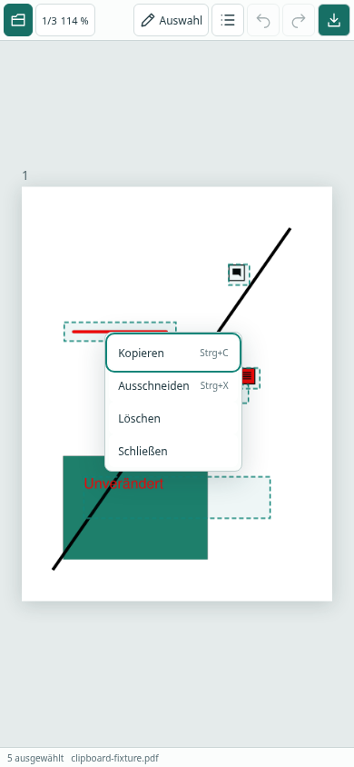
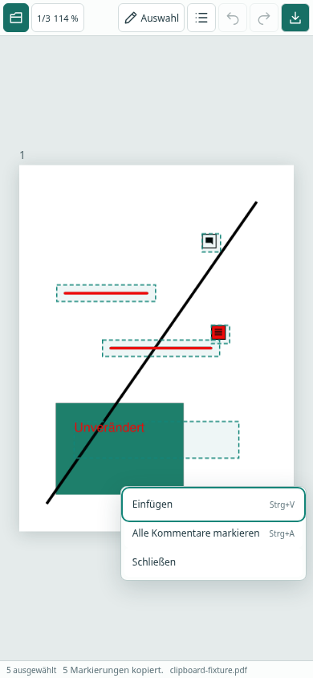

# Kontextmenü und Annotations-Zwischenablage

Im Werkzeug **Auswählen / Verschieben**:

- Rechtsklick oder etwa 600 ms lang drücken auf eine ausgewählte Markierung: **Kopieren**, **Ausschneiden**. Die gesamte bestehende Auswahl bleibt erhalten. Auf einem noch nicht ausgewählten bearbeitbaren Objekt wird dieses zuerst ausgewählt.
- Rechtsklick oder lang drücken auf freie Blattfläche: **Einfügen**, **Alle Kommentare markieren**. Einfügen ist ohne kopierten Inhalt deaktiviert.
- Das Menü bleibt im sichtbaren Browserbereich. Escape, Schließen oder ein Klick außerhalb schließen es. Pfeiltasten/Home/End navigieren im Menü.
- Bewegung von mehr als 8 CSS-Pixeln, Loslassen, Abbruch, Escape, Zoom oder ein zweiter Finger stoppen die Langdruck-Erkennung. Das Öffnen des Menüs verwirft nur die laufende Geste, ohne Annotationen zu verschieben.
- Strg+A/C/X/V (auch Cmd) wählen aus, kopieren, schneiden aus und fügen ein. Eingaben in Text-/Eigenschaftsfeldern sind davon ausgenommen. Die vorhandenen Kürzel für Undo/Redo/Download bleiben erhalten.

## Einfügeposition und Lebensdauer

Die linke obere Ecke des Gruppenrahmens wird an die Kontextmenü-Position gesetzt. Strg+V verwendet die letzte Mausposition auf der aktiven PDF-Seite, ansonsten die Mitte des sichtbaren Bereichs, auf das Blatt begrenzt. Abstände und Größen der Gruppe bleiben in Seitenansichtskoordinaten erhalten. Kopierte Textfelder behalten auch ihre individuelle Drehung relativ zur Seite.

Die App-Zwischenablage ist eine unabhängige Momentaufnahme. Spätere Änderungen am Original verändern die Kopie nicht. Sie bleibt bei Seiten- und PDF-Wechseln in derselben App-Sitzung erhalten. Neuladen/Schließen des Tabs verwirft sie. Kein Zugriff auf die Systemzwischenablage, keine Übertragung, keine dauerhafte Speicherung. Extern kopierte PDF-Objekte/Text werden dadurch nicht als Annotationen importiert; Textfelder behalten ihre normale Browser-Zwischenablage.

Auswahl/Kopieren verändert die PDF nicht. Ausschneiden entfernt die ausgewählten Objekte als eine Undo-Operation; Einfügen erzeugt die gesamte Gruppe als eine weitere Undo-Operation. Undo stellt beim Ausschneiden alle Objekte wieder her bzw. entfernt beim Einfügen alle neu erzeugten Objekte. Die Zwischenablage bleibt dabei verfügbar.

## Native PDF-Umsetzung

Der Worker erstellt eine kleine eigenständige PDF mit den nativen Annotation-Dictionaries und ihren Appearance-/Ressourcenobjekten. Seiten-/Popup-/Antwortverknüpfungen und alte Annotation-Identitäten werden nicht übernommen. Zielobjekte bekommen neue IDs; beim Erzeugen eingetragene Standardwerte werden vor dem Kopieren entfernt, damit z. B. fehlende Farben oder Druckflags nicht ergänzt werden; Inhalt, Geometrie, Farbe, Transparenz, Rahmen und unterstützte weitere Eigenschaften stammen aus der Momentaufnahme. Ink-Koordinaten sowie Rect/Rotate werden in die Zielseitenansicht übertragen.

Ausschneiden/Einfügen verwenden jeweils eine MuPDF-Journaloperation. Ungültige Gruppen oder fehlgeschlagene Einfügungen werden vollständig zurückgenommen. Export-Replay berücksichtigt auch mehrere durch einen Paste erzeugte IDs, einschließlich späterer Änderungen, Löschung, Undo/Redo und neuer Historienzweige.

Grenzen: bearbeitbare Ink-, Text- und einfache FreeText-Annotationen; geschützte oder nicht unterstützte Typen werden weder kopiert noch mit „Alle Kommentare markieren“ ausgewählt. Zwischenablage-PDF maximal 20 MB. Keine vollständige Kompatibilitätszusage für beliebige Drittanbieter-Sonderdaten oder Schriften.

## Tatsächliche Prüfungen

Codex Cloud:

- TypeScript/Produktionsbuild und ESLint bestanden.
- 34 Unit-/Integrationstests: unveränderte Momentaufnahme, native Eigenschaften/Appearance, Gruppen-Cut/Paste und Undo/Redo, Rücknahme fehlgeschlagener Operationen, ID-Abbildung nach Historienzweig und wiederholtem Export, gedrehte Zielseite und individuelle FreeText-Rotation.
- 19 Chromium-Browsertests bestanden; zusätzliche Zwischenablage-Prüfungen nach Ergänzungen gezielt wiederholt.
- Rechtsklick-Menüs mit fünf ausgewählten Annotationen; zunächst deaktiviertes Einfügen; Copy/Paste und Cut/Undo/Redo als ganze Gruppe. Heruntergeladene PDF wieder eingelesen und die Positionen/Inhalte aller Kopien überprüft. Neue IDs und Appearance-Streams vorhanden; originale Objekte bleiben erhalten. Auch die tatsächlich gerenderten roten Pixel einer eingefügten Linie werden geprüft.
- Strg+A/C/X/V mit Seitenwechsel, gedrehter CropBox, normaler Texteingabe in den Eigenschaften und anschließender Verwendung der Zwischenablage nach PDF-Wechsel.
- Touch bei 390 × 844 mit echten Chromium-CDP-Ereignissen: lang drücken auf eine Auswahl und auf freie Fläche, kein versehentliches Verschieben, Menü innerhalb des Bildschirms, Abbruch bei Bewegung/zweitem Finger.
- CI prüft zusätzlich in Firefox Layout, Gruppenauswahl und Zwischenablage. Die beiden CDP-Touchtests werden dort ausdrücklich übersprungen. Abschließende CI-Links/Ergebnisse im PR.

| Auf einer Auswahl | Auf freier Blattfläche |
| --- | --- |
|  |  |

Nur synthetische Test-PDFs. Touch-Emulation ersetzt keine Prüfung auf einem physischen Android-/iOS-Gerät. Keine neue Acrobat- oder native Desktop-Bedienprüfung. Die öffentliche [Browser-Vorschau](https://roju0ch.github.io/PDF-Annotation-Editor/) wird erst nach Review/Merge und erfolgreichem Pages-Workflow aktualisiert.
