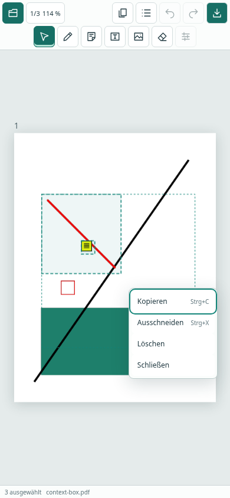
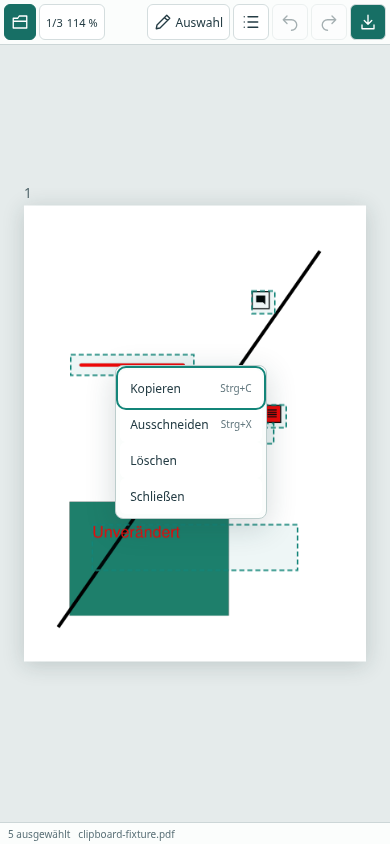
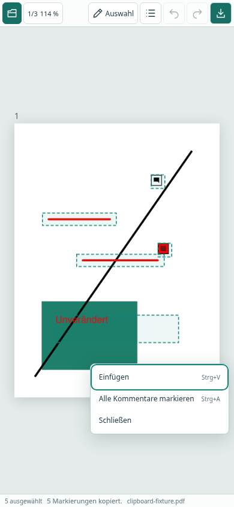

# Kontextmenü und Annotations-Zwischenablage

Im Werkzeug **Auswählen / Verschieben**:

- Rechtsklick oder etwa 600 ms lang drücken **innerhalb der gesamten Auswahlbox**: **Kopieren**, **Ausschneiden**, **Löschen**. Die gesamte bestehende Auswahl bleibt erhalten; die Linie selbst muss nicht getroffen werden. Bei mehreren ausgewählten Objekten gilt der gemeinsame sichtbare Rahmen, einschließlich der Lücken dazwischen. Die bestehende Auswahl hat innerhalb dieses Rahmens Vorrang vor anderen darunterliegenden Objekten. Außerhalb des Rahmens wird ein getroffenes, noch nicht ausgewähltes bearbeitbares Objekt zuerst ausgewählt.
- Rechtsklick oder lang drücken auf freie Blattfläche **außerhalb der Auswahlbox**: **Einfügen**, **Alle Kommentare markieren**. Einfügen ist ohne kopierten Inhalt deaktiviert.
- Das Menü bleibt im sichtbaren Browserbereich. Es öffnet sich auch während eines laufenden Kopiervorgangs; Aktionen bleiben bis zu dessen Abschluss deaktiviert. Escape, Schließen oder ein Klick außerhalb schließen es. Pfeiltasten/Home/End navigieren im Menü.
- Bewegung von mehr als 8 CSS-Pixeln, Loslassen, Abbruch, Escape, Zoom oder ein zweiter Finger stoppen die Langdruck-Erkennung. Das Öffnen des Menüs verwirft nur die laufende Geste, ohne Annotationen zu verschieben.
- Strg+A/C/X/V (auch Cmd) wählen aus, kopieren, schneiden aus und fügen ein. Eingaben in Text-/Eigenschaftsfeldern sind davon ausgenommen. Die vorhandenen Kürzel für Undo/Redo/Download bleiben erhalten.

## Texte direkt bearbeiten (Issue #18)

Bei genau einem bearbeitbaren Textfeld (`FreeText`) oder einer unterstützten Haftnotiz (`Text`) steht **Bearbeiten** vor Kopieren/Ausschneiden/Löschen. Rechtsklick beziehungsweise derselbe 600-ms-Langdruck funktioniert auf dem Objekt oder innerhalb seines vorhandenen Auswahlrahmens. Ein bisher nicht ausgewähltes Objekt wird zuerst ausgewählt. Innerhalb einer Mehrfachauswahl hat der Gruppenrahmen weiterhin Vorrang; dort erscheint kein mehrdeutiges Einzelobjekt-Bearbeiten. Freihand, Bilder, gesperrte Objekte und geschützte RichText-/Callout-Textfelder erhalten keinen Bearbeiten-Eintrag.

Der vorhandene Textdialog öffnet sich unmittelbar vorausgefüllt, ohne die Annotationsliste einzublenden. Textfelder bieten Schriftgröße, Textfarbe und Hintergrundfarbe/Transparenz; Haftnotizen ihren Text und ihre Notizfarbe. Der Text erhält den Fokus, Tab/Shift+Tab bleiben im Dialog, nach dem Schließen erhält die PDF-Arbeitsfläche den Fokus zurück. **Übernehmen** sendet nur geänderte Eigenschaften an die bestehende native Objekt-ID. Unverändertes Bestätigen, **Abbrechen** und Escape schreiben keinen Undo-Eintrag. Fehler lassen Eingabe und Dialog bestehen. Editierentwürfe verändern keine Voreinstellungen für neue Textfelder.

[Bearbeitungsdialog im Chromium-Touchtest bei 390 × 450 Pixeln](images/context-edit-touch.png), ausschließlich mit synthetischer PDF aufgenommen. Der reduzierte Viewport prüft begrenzten Platz, ohne eine echte Android-Bildschirmtastatur zu emulieren.

Automatische Größenänderung bleibt auf entsprechend markierte eigene Textfelder beschränkt; fremde Textfelder behalten ihre Abmessungen. Der native Update-/Undo-/Exportpfad wird wiederverwendet. Die bestehenden Schutzmechanismen gegen Fingerbewegung, Zweitfinger, Escape und Zoom/Pan bleiben erhalten. `tests/e2e/context-edit.spec.ts` prüft Desktop-Zugriff, Auswahlrahmen, native IDs, Undo/Redo/Export/Reopen, Gruppen und geschützte Objekte sowie Chromium-Touch. Touch-Ereignisse sind emuliert; reale Android-Tastatur, System-WebViews und macOS-Zwei-Finger-Sekundärklick bleiben am Gerät zu prüfen.

## Einfügeposition und Lebensdauer

Die linke obere Ecke des Gruppenrahmens wird an die Kontextmenü-Position gesetzt. Strg+V verwendet die letzte Mausposition auf der aktiven PDF-Seite, ansonsten die Mitte des sichtbaren Bereichs, auf das Blatt begrenzt. Abstände und Größen der Gruppe bleiben in Seitenansichtskoordinaten erhalten. Kopierte Textfelder behalten auch ihre individuelle Drehung relativ zur Seite.

Die App-Zwischenablage ist eine unabhängige Momentaufnahme. Spätere Änderungen am Original verändern die Kopie nicht. Sie bleibt bei Seiten- und PDF-Wechseln in derselben App-Sitzung erhalten. Neuladen/Schließen des Tabs verwirft sie. Die PDF-Objekte verbleiben lokal im Arbeitsspeicher; keine Übertragung oder dauerhafte Speicherung. Kopieren setzt soweit möglich eine leere App-Markierung in der Systemzwischenablage, damit alte Bilder nicht die Annotationskopie verdrängen. Externe PNG-/JPEG-Bilder können inzwischen per Strg+V oder über **Bild aus Zwischenablage** übernommen werden; siehe [Bildannotation](IMAGE_ANNOTATIONS.md). Extern kopierte PDF-Objekte/Text werden nicht importiert; Textfelder behalten ihre normale Browser-Zwischenablage.

Auswahl/Kopieren verändert die PDF nicht. Ausschneiden entfernt die ausgewählten Objekte als eine Undo-Operation; Einfügen erzeugt die gesamte Gruppe als eine weitere Undo-Operation. Undo stellt beim Ausschneiden alle Objekte wieder her bzw. entfernt beim Einfügen alle neu erzeugten Objekte. Die Zwischenablage bleibt dabei verfügbar. **Löschen** entfernt die gesamte Auswahl ebenfalls als eine Undo-Operation, ohne die Zwischenablage zu ändern. Rückgängig stellt alle gelöschten Objekte gemeinsam wieder her.

## Native PDF-Umsetzung

Der Worker erstellt eine kleine eigenständige PDF mit den nativen Annotation-Dictionaries und ihren Appearance-/Ressourcenobjekten. Seiten-/Popup-/Antwortverknüpfungen und alte Annotation-Identitäten werden nicht übernommen. Zielobjekte bekommen neue IDs; beim Erzeugen eingetragene Standardwerte werden vor dem Kopieren entfernt, damit z. B. fehlende Farben oder Druckflags nicht ergänzt werden; Inhalt, Geometrie, Farbe, Transparenz, Rahmen und unterstützte weitere Eigenschaften stammen aus der Momentaufnahme. Ink-Koordinaten sowie Rect/Rotate werden in die Zielseitenansicht übertragen.

Ausschneiden/Einfügen verwenden jeweils eine MuPDF-Journaloperation. Ungültige Gruppen oder fehlgeschlagene Einfügungen werden vollständig zurückgenommen. Export-Replay berücksichtigt auch mehrere durch einen Paste erzeugte IDs, einschließlich späterer Änderungen, Löschung, Undo/Redo und neuer Historienzweige.

Grenzen: bearbeitbare Ink-, Text-, einfache FreeText- und Bildstempel-Annotationen; geschützte oder nicht unterstützte Typen werden weder kopiert noch mit „Alle Kommentare markieren“ ausgewählt. Zwischenablage-PDF maximal 20 MB. Keine vollständige Kompatibilitätszusage für beliebige Drittanbieter-Sonderdaten oder Schriften.

## Auswahlbox als Kontextfläche

Die Kontextfläche und der gemeinsame Gruppenrahmen verwenden dieselben Grenzen in PDF-Koordinaten. Sie gelten für bearbeitbare ausgewählte Objekte auf der aktiven Seite und folgen Zoom, Seitendrehung und CropBox. Präzise Stricherkennung beim normalen Auswählen und Ziehen bleibt bestehen.

Bei Touch innerhalb der Auswahlbox wird der Beginn der normalen Auswahlgeste bis zur Unterscheidung von kurzem Tippen, Ziehen und Langdruck aufgeschoben. Dadurch wählt ein Langdruck auf einem darunterliegenden anderen Objekt nicht versehentlich dieses aus. Kleine Fingerbewegungen innerhalb der Langdruck-Toleranz verschieben die Seite nicht. Kurzes Tippen führt weiterhin die normale Auswahl aus; Bewegung über 8 CSS-Pixel startet die normale Ziehgeste und verhindert das Menü. Ein zweiter Finger bricht die wartende Geste ab.

Drei zusätzliche Browsertests prüfen freie Stellen in der Box einer diagonalen Linie, Lücken in einer Gruppe, ein anderes und ein gesperrtes Objekt unter dem Rahmen, unveränderte Auswahl, Löschen/Undo, die weiterhin freie Fläche außerhalb sowie eine gedrehte CropBox bei Zoom. Chromium-Touch prüft Langdruck mit leichtem Fingerzittern, kurzes Tippen und Abbruch durch Bewegung/zweiten Finger. Die Mausfälle laufen auch in Firefox. Abschließende Testzahlen und CI-Links stehen im PR.

## Frühere Prüfungen

Ergänzung **Löschen im Kontextmenü**: Typecheck, Lint und vier gezielte Chromium-Browsertests bestanden. Per Rechtsklick drei von fünf Objekten gelöscht, Download mit nativen PDF-Objekten geprüft (übrige Objekte und andere Seite unverändert), Gruppe mit einem Undo/Redo wiederhergestellt/erneut gelöscht und zuvor kopierte fünf Objekte anschließend unverändert eingefügt. Bei 390 × 844 per Langdruck geöffnet und per simuliertem Touch-Tap alle fünf Objekte gelöscht; ein Undo stellt die Gruppe wieder her. Aktuelles CI-Ergebnis steht im zugehörigen PR.

Codex Cloud:

- TypeScript/Produktionsbuild und ESLint bestanden.
- 34 Unit-/Integrationstests: unveränderte Momentaufnahme, native Eigenschaften/Appearance, Gruppen-Cut/Paste und Undo/Redo, Rücknahme fehlgeschlagener Operationen, ID-Abbildung nach Historienzweig und wiederholtem Export, gedrehte Zielseite und individuelle FreeText-Rotation.
- 19 Chromium-Browsertests bestanden; zusätzliche Zwischenablage-Prüfungen nach Ergänzungen gezielt wiederholt.
- Rechtsklick-Menüs mit fünf ausgewählten Annotationen; zunächst deaktiviertes Einfügen; Copy/Paste und Cut/Undo/Redo als ganze Gruppe. Heruntergeladene PDF wieder eingelesen und die Positionen/Inhalte aller Kopien überprüft. Neue IDs und Appearance-Streams vorhanden; originale Objekte bleiben erhalten. Auch die tatsächlich gerenderten roten Pixel einer eingefügten Linie werden geprüft.
- Strg+A/C/X/V mit Seitenwechsel, gedrehter CropBox, normaler Texteingabe in den Eigenschaften und anschließender Verwendung der Zwischenablage nach PDF-Wechsel.
- Touch bei 390 × 844 mit echten Chromium-CDP-Ereignissen: lang drücken auf eine Auswahl und auf freie Fläche, kein versehentliches Verschieben, Menü innerhalb des Bildschirms, Abbruch bei Bewegung/zweitem Finger.
- CI prüft zusätzlich in Firefox Layout, Gruppenauswahl und Zwischenablage. Die beiden CDP-Touchtests werden dort ausdrücklich übersprungen. Abschließende CI-Links/Ergebnisse im PR.

| Auf einer Auswahl                                                | Auf freier Blattfläche                                          |
| ---------------------------------------------------------------- | --------------------------------------------------------------- |
|  |  |

Nur synthetische Test-PDFs. Touch-Emulation ersetzt keine Prüfung auf einem physischen Android-/iOS-Gerät. Keine neue Acrobat- oder native Desktop-Bedienprüfung. Die öffentliche [Browser-Vorschau](https://roju0ch.github.io/PDF-Annotation-Editor/) wird erst nach Review/Merge und erfolgreichem Pages-Workflow aktualisiert.
