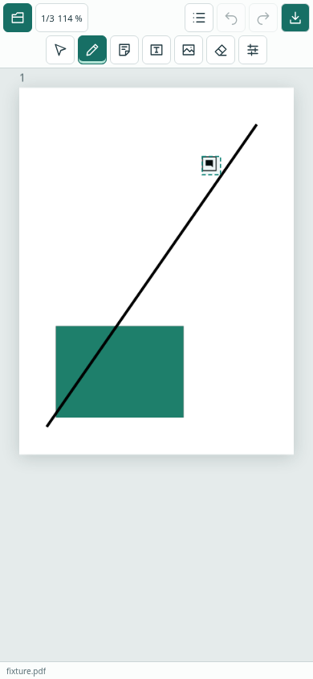
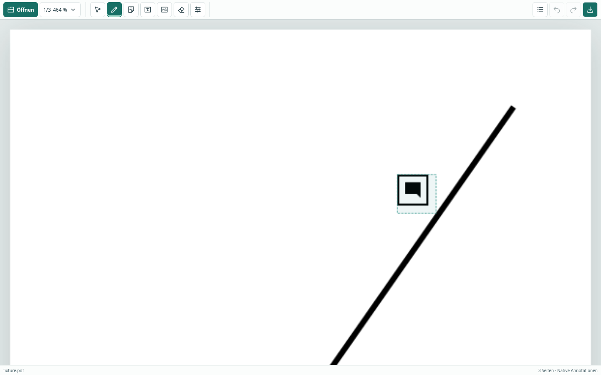

# Direkte Werkzeugsymbole

Die Werkzeugauswahl erfolgt ohne Dropdown direkt in der Hauptleiste, in dieser Reihenfolge:

| Symbol | Funktion |
| --- | --- |
| Mauszeiger | Auswählen / Verschieben |
| Stift | Freihand |
| Haftnotiz | Notiz |
| T im Rahmen | Textfeld |
| Bild | PNG-/JPEG-Datei auswählen und als Bildannotation einfügen |
| Radierer | Ink-Teilradierer (Klick) |
| Regler | Eigenschaften des aktiven Zeichenwerkzeugs |

Das aktive Werkzeug erhält eine grüne Fläche und eine zusätzliche untere Markierung; `aria-pressed` vermittelt den Zustand auch an Hilfstechniken. Das Bildsymbol ist eine Einfügeaktion, kein dauerhaft aktives Zeichenwerkzeug. Auswahl benötigt keine Zeichenparameter; der Regler ist dort deaktiviert. Kommentar-/Objekteigenschaften bleiben im Annotationsmenü hinter dem Listensymbol.

Die Eigenschaften zeigen nur passende Felder: Farbe und Strichbreite für Freihand, Farbe/Text für Notizen, zusätzlich Schriftgröße für Textfelder, Radius für den Teilradierer. Ein direkter Werkzeugwechsel schließt offene Menüs und verwirft nur eine laufende Geste. Nicht übernommene Änderungen an Annotations-Eigenschaften blockieren den Werkzeugwechsel weiterhin, bis sie übernommen oder verworfen wurden.

## Platz und Bedienung

- Ab 721 CSS-Pixeln Breite: eine Zeile mit Dokumentsteuerung, Werkzeugen und Dokumentaktionen.
- Bis 720 Pixel Breite: oben Öffnen, Seite/Zoom, Annotationsliste, Undo/Redo und Download; darunter die Werkzeugsymbole. Keine horizontale Scrollleiste.
- Symbole mindestens 36 × 36 CSS-Pixel, Hauptleiste mobil 85 Pixel hoch, Statuszeile bei schmalen Geräten 22 Pixel. Bei 390 × 844 bleiben rund 87 % der App-Fläche als PDF-Arbeitsfläche; bei 320 × 568 über 80 %. Browser-/Betriebssystemleisten sind darin nicht enthalten.
- Maus: kurzer Hinweis beim Darüberfahren. Tastatur: Hinweis bei Fokus, Pfeiltasten/Home/End bewegen den Fokus innerhalb der Werkzeuggruppe, Enter/Leertaste aktivieren. Escape schließt den Hinweis ohne die PDF-Auswahl zu verändern. Alle Schaltflächen besitzen deutsche zugängliche Namen.
- Hinweise werden am Fensterrand begrenzt. Touch-Tippen schaltet direkt das Werkzeug um; ein Hover-Hinweis ist dafür nicht erforderlich.

## Tatsächliche Prüfung

Die vorhandenen Browserprüfungen verwenden nun direkte Symbolklicks statt einer Werkzeug-Dropdownliste. Layouts bei 320 × 568, 390 × 844, 844 × 390 und 1440 × 900 prüfen Arbeitsfläche, Leistenhöhe, Zeilenanordnung, Mindestgröße und Sichtbarkeit aller Werkzeuge sowie fehlendes horizontales Überlaufen. Zusätzlich geprüft: aktiver Zustand, Hover-Hinweis am Rand, Tastaturnavigation und Aktivierung, Escape, passende Eigenschaften, Menüschließen beim Werkzeugwechsel und Erhalt nicht übernommener Kommentaränderungen.

Zeichnen, Notizen/Textfelder, Auswahl/Gruppenbewegung, Radieren, native Exporte, Bilddateiauswahl, Zwischenablage, Touch-Gesten und Zoom/Pan laufen über die bestehenden Tests weiter. Abschließende Testzahlen und CI-Links stehen im PR. Keine neue native Desktop-Bedienprüfung oder Prüfung auf physischen Mobilgeräten; Screenshots und Touch-Tests stammen aus Browser-Emulation.

## Screenshots

