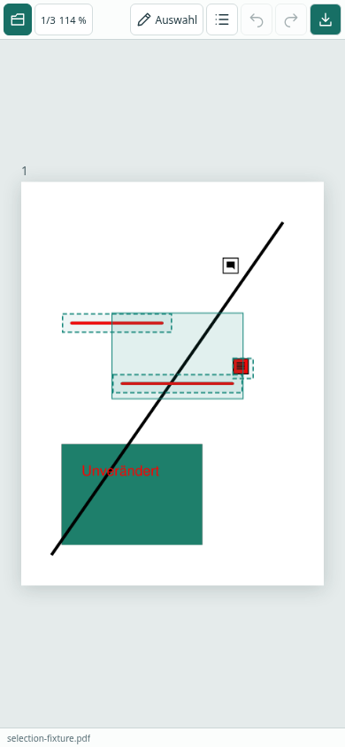
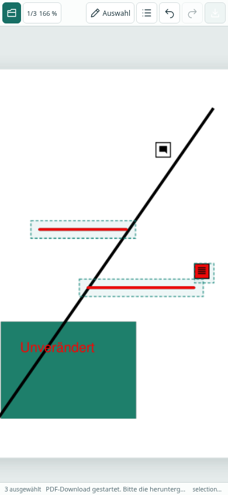

# Auswahlbox und gemeinsames Verschieben

Im Werkzeug **Auswählen / Verschieben** auf freier Fläche ziehen. Die Box funktioniert in beide Richtungen und kann auch außerhalb des Blatts beginnen. Berührung genügt: Bei Freihand werden die Striche einschließlich Strichbreite geprüft; leere Zwischenräume und bloß überlappende Ink-Begrenzungsrahmen zählen nicht. Bei Notizen und Textfeldern zählt deren Rechteck. Treffer werden bereits während des Ziehens hervorgehoben.

Nach dem Loslassen bleibt die Gruppe ausgewählt. An einer ihrer Markierungen ziehen, um alle um denselben Betrag zu verschieben. Die Auswahlrahmen zeigen während des Ziehens die Zielposition; beim Loslassen werden die nativen PDF-Objekte verändert und neu gerendert. Unten steht die Anzahl der ausgewählten Markierungen. Das Annotationsmenü öffnet sich nicht automatisch.

- **Rückgängig/Wiederholen:** Die gesamte Gruppenbewegung ist jeweils eine Operation.
- **Escape:** Laufende Auswahl/Verschiebung abbrechen; ohne laufende Geste die Auswahl aufheben. Ungesicherte Eigenschaftseingaben bleiben geschützt.
- **Klick auf freie Fläche:** Auswahl aufheben. Zum Wechsel auf ein einzelnes Objekt dieses anklicken oder die Annotationsliste verwenden.
- **Mittelmaus / Leertaste + Ziehen:** Ansicht bewegen, Auswahl bleibt erhalten.
- **Touch:** Ein Finger für Auswahlbox oder Gruppenbewegung; zwei Finger für Pan/Zoom. Der zweite Finger bricht eine laufende Bearbeitung ab, ohne sie in der PDF zu speichern.

Die Auswahl gilt für die aktuelle Seite und die bisher unterstützten bearbeitbaren Typen Ink, Text und FreeText. Geschützte und nicht unterstützte Objekte werden von der Box nicht ausgewählt und nicht verschoben. Keine seitenübergreifende Gruppe und keine dauerhafte Gruppierung im PDF-Format: Die Annotationen bleiben einzeln bearbeitbare native Objekte.

## Umsetzung und Nachweis

Der Worker verarbeitet eine Gruppenverschiebung als eine MuPDF-Journaloperation. Bei einem ungültigen, fehlenden oder geschützten Ziel wird die ganze Operation zurückgenommen. Beim Export werden auch die IDs der Gruppenmitglieder auf die neu aufgebauten PDF-Objekte abgebildet. Auswahlbox und Auswahlrahmen allein verändern die PDF nicht und erzeugen keinen Undo-Schritt.

Codex Cloud:

- TypeScript/Produktionsbuild und ESLint bestanden.
- 29 Unit-/Integrationstests bestanden: einschließlich geometrischer Berührung, Randkontakt/Strichbreite, leeren Ink-Zwischenräumen, geschützten Objekten, atomarem Rollback und Gruppen-Undo/Redo/Export auf normaler und gedrehter Seite.
- 16 Chromium-Browsertests bestanden; die drei Gruppenprüfungen nach Ergänzung um Mittelmaus-Pan und Escape erneut bestanden.
- Browser öffnet eine synthetische PDF mit zwei Freihandlinien, einer Notiz und einem nicht ausgewählten Textfeld. Auswahlbox schneidet die Linien nur teilweise. Download nach Gruppenbewegung, Undo und Redo wird mit MuPDF erneut gelesen; alle drei ausgewählten Objekte haben denselben geprüften Versatz, das Textfeld bleibt unverändert.
- Zweite Seite mit gedrehter CropBox, zusätzlicher Zoom und rückwärts gezogene Box getestet.
- Mobile Ansicht 390 × 844: echte Touch-Ereignisse über Chromium-CDP für Auswahl, Gruppenbewegung und Abbruch durch den zweiten Finger.
- CI führt zusätzlich die fünf Layouttests und zwei Gruppenprüfungen in Firefox aus. Der CDP-Touchtest wird dort ausdrücklich übersprungen. Tatsächliche CI-Ergebnisse stehen im PR.

| Auswahlbox während des Ziehens | Gruppe nach Verschiebung und Pinch |
| --- | --- |
|  |  |

Nur synthetische Testdaten. Browser-Emulation ersetzt keinen Test auf einem echten Telefon. Firefox wird auf dem GitHub-Runner geprüft, da sein Download in der Codex-Umgebung durch die Netzwerkregel blockiert wird. Keine neue Acrobat-/native Desktop-Bedienprüfung für diesen Schritt.

Nach Review/Merge und erfolgreichem **Browser preview**-Workflow ist die Änderung in der [Browser-Vorschau](https://roju0ch.github.io/PDF-Annotation-Editor/) verfügbar.
