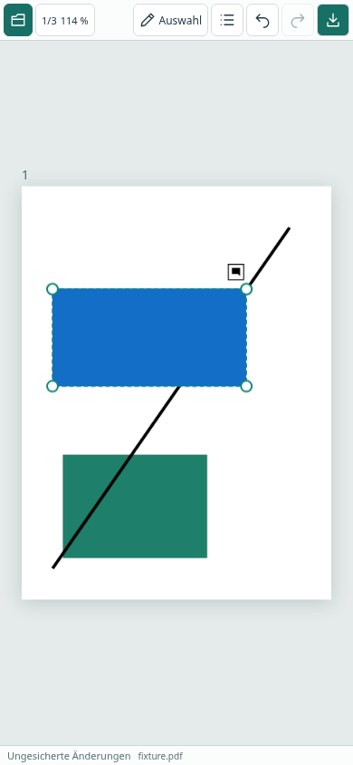

# Screenshots und Bilder als PDF-Annotation

## Bedienung

- PNG-/JPEG-Screenshot kopieren, PDF-Arbeitsfläche aktivieren und **Strg/Cmd+V** drücken. Textfelder behalten ihre normalen Textkürzel.
- Im Auswahlwerkzeug auf freie Blattfläche rechtsklicken/lang drücken: **Bild aus Zwischenablage** liest nach dieser bewussten Aktion ein Bild aus der Systemzwischenablage. Je nach Browser ist eine Freigabe erforderlich. Bei Ablehnung/fehlender Unterstützung erscheint eine verständliche Meldung.
- **Bild einfügen …** im Kontext- oder Werkzeugmenü öffnet die native Dateiauswahl (mobil je nach System Dateien/Galerie). PNG und JPEG werden unterstützt.
- Platzierung an der Menüposition bzw. letzten Mausposition auf dem aktiven Blatt, sonst in der sichtbaren Mitte. Das Anfangsrechteck wird auf das Blatt begrenzt, maximal 60 % der Seitenabmessungen und 320 PDF-Punkte breit. Größenverhältnis bleibt erhalten.
- Ein einzelnes Bild auswählen. Vier Eckgriffe erlauben proportionale Größenänderung; Ziehen im Bild verschiebt es. Während des Ziehens zeigt der Auswahlrahmen die neue Größe; nach dem Loslassen wird das native Bild aktualisiert. Escape oder ein zweiter Finger bricht die laufende Geste ab.
- **Annotationen → Inhalt → Übernehmen** setzt den Kommentartext. Dieser ist Annotationsinhalt, kein ins Bild gemalter Text. Bilder können auch gemeinsam mit anderen Annotationen ausgewählt, verschoben, kopiert, ausgeschnitten und gelöscht werden.
- Einfügen, Skalieren, Verschieben, Kommentaränderung und Löschen sind rückgängig machbar. PDF herunterladen und erneut öffnen, um weiterzuarbeiten.

## Zwischenablage und Datenschutz

Ein natives `paste`-Ereignis liefert Bilder für Strg+V; ohne solches Ereignis bleibt die bisherige interne Annotations-Zwischenablage nutzbar. Ein Bild im Ereignis hat Vorrang, fremder Text/HTML wird nicht versehentlich durch alte Annotationen ersetzt. Der Menüpunkt **Einfügen** bleibt für intern kopierte Annotationen; **Bild aus Zwischenablage** ist ausdrücklich für externe Bilder.

Annotations-Kopieren/Ausschneiden setzt über ein synchrones Browser-Copy-Ereignis eine App-Markierung mit leerem Text in der Systemzwischenablage. So überschreibt diese ausdrückliche Kopieraktion ein altes Screenshot-Bild. Die nativen PDF-Objekte selbst verbleiben in der App; sie sind außerhalb der App nicht einfügbar. Verweigert der Browser das Schreiben, bleibt die interne Kopie über **Einfügen** verfügbar. Kopieren eines neuen Screenshots außerhalb der App ersetzt die Markierung wieder. Kein Clipboard-Polling und kein Lesen ohne Einfügeaktion, kein Upload, keine neue Berechtigung für Tauri.

Pro Bild maximal **20 MB**, **20 Megapixel** und **16.384 Pixel je Kante**, geprüft anhand des PNG-/JPEG-Headers vor dem Decodieren; größere Bilder werden mit einer klaren Meldung abgelehnt. Die Pixel werden nicht stillschweigend heruntergerechnet. Das PDF-Exportlimit von 150 MB gilt weiterhin. Viele große Bilder und Undo-Historie können trotzdem viel Arbeitsspeicher benötigen.

## Native Speicherung und Engine-Besonderheiten

Eigener PDF-Annotationstyp `/Subtype /Stamp`, Intent `/IT /StampImage`, Druckflag und Bild-XObject im normalen Appearance-Stream (`/AP /N`). PNG-Alpha wird als Soft Mask eingebettet. Kein Flattening und keine Änderung der Seiteninhalte. Bilddaten, Appearance und Kommentar werden beim Export auf Originalbytes wiedergegeben; neue Objekt-IDs sind auch nach Kopieren, Undo und erneutem Bearbeiten zugeordnet.

Die Appearance-Matrix gleicht die Seitendrehung aus. Beim Kopieren auf anders gedrehte Seiten kapselt ein neues Form-XObject die bisherige Appearance; geteilte Quellressourcen werden nicht verändert. Bei späterer Größen-/Kommentaränderung wird die vorhandene Appearance ausdrücklich beibehalten, da MuPDF sonst die Stamp-Matrix regeneriert und die Orientierung verliert.

MuPDF.js 1.28.6 deklariert `StampImage` in der Intent-API, sein Setter schreibt im überprüften Fall jedoch `null`. Deshalb wird der native PDF-Name direkt gesetzt und gelesen. Allgemeine Fremdstempel ohne diesen Bild-Intent sowie geschützte Stempel bleiben unverändert und nicht bearbeitbar.

## Tatsächliche Prüfung

- Unit-/Integrationstests prüfen native Stamp-Objekte, Bildressourcen und Alpha-Maske; gerenderte rote/grüne Bildbereiche vor/nach Größen-/Kommentaränderung, auf normaler und gedrehter CropBox-Seite, nach Kopieren auf anders gedrehte Seiten sowie Export/Wiederöffnen; Löschen/Undo, ungültige und übergroße Bilder, proportionale Eckgriffe.
- Browser: PNG-Dateiauswahl auf gedrehter Seite, echte Canvas-Pixel, Skalieren/Verschieben, Kommentar, Annotationskopie und Download mit nativen Stempeln. Chromium liest außerdem eine tatsächlich mit `navigator.clipboard.write` gefüllte PNG-Systemzwischenablage per Strg+V und Menü; danach wird die Annotationskopie geprüft.
- Chromium-Touch bei 390 × 844: JPEG-Dateiauswahl, simulierte Touch-Größenänderung und Undo. Verweigerter Clipboard-Zugriff wird gezielt injiziert; anschließend funktioniert die Dateiauswahl.
- Firefox-CI prüft den Datei-/Bearbeitungs-/Exportweg; System-Clipboard-Berechtigungen und CDP-Touch sind dort nicht automatisiert. Abschließende Testzahlen, CI-Links und unabhängige Rendererprüfung im PR.

Grenzen: keine Zusage für echte Android-/iOS-Geräte ohne separate Prüfung, keine neue native Desktop-Bedienprüfung, Acrobat/PDF Expert hier nicht verfügbar. HEIC, GIF, SVG, beliebige HTML-/Office-Inhalte und reine Text-Zwischenablage als neue Annotation sind nicht enthalten. Keine Bildbearbeitung/Zuschneiden oder manuelle Rotation. JPEG-EXIF-Kameraausrichtung wird nicht eigens normalisiert. Nicht unterstützte Formate bitte vorher als PNG/JPEG exportieren.
