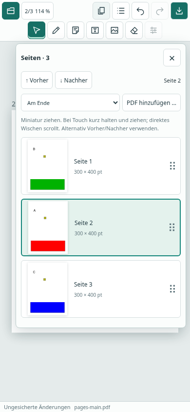
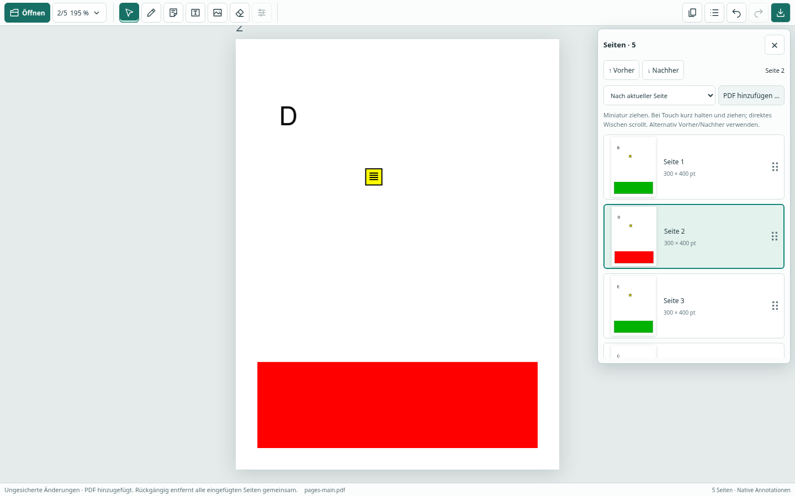

# Seiten sortieren und PDFs hinzufügen

Das **Seitensymbol** in der Hauptleiste öffnet die Seitenübersicht als überlagertes Menü. Die PDF-Arbeitsfläche bleibt bei geschlossenem Menü unverändert groß.

- Eine Miniatur anklicken, um die Seite anzuzeigen.
- Mit der Maus eine Miniatur an die gewünschte Einfügelinie ziehen. Am oberen/unteren Listenrand scrollt die Liste automatisch weiter.
- Auf dem Telefon die Miniatur etwa **0,4 Sekunden halten**, dann ziehen. Sofortiges Wischen scrollt die Liste. Escape, Abbruch der Berührung oder Fokusverlust verwerfen eine laufende Verschiebung.
- Alternativ die aktuelle Seite mit **Vorher / Nachher** verschieben; die Schaltflächen sind auch per Tastatur bedienbar.
- **PDF hinzufügen …** fügt alle Seiten einer ausgewählten PDF **am Ende** oder **nach der aktuellen Seite** ein. Anschließend wird die erste hinzugefügte Seite angezeigt. Mehrere Dateien können nacheinander hinzugefügt werden.
- Jede Verschiebung und jeder Import ist ein einzelner **Rückgängig-/Wiederholen**-Schritt. Nicht übernommene Änderungen im Eigenschaftenformular müssen zuerst übernommen oder verworfen werden.
- **PDF herunterladen** speichert die neue Reihenfolge und hinzugefügten Seiten in einer neuen Datei. Originaldateien werden nicht verändert. Ohne Export gehen Änderungen beim Schließen verloren.

## Erhalt der PDF-Objekte

Seiten werden im nativen PDF-Seitenbaum umgeordnet. Der Import überträgt native Seitenobjekte und deren Ressourcen, Annotationen und Appearance-Streams mit einer gemeinsamen MuPDF-GraftMap. Kein Rastern oder Flattening. Nicht unterstützte Annotationen bleiben erhalten. Popup-/Antwortbeziehungen und interne Seitenverweise werden mitkopiert. Benannte interne Ziele der Quelldatei werden vor dem Kopieren zu expliziten Seitenzielen aufgelöst, damit gleiche Zielnamen unterschiedlicher PDFs nicht kollidieren. Importierte Lesezeichen werden unter dem Quelldateinamen zusammengefasst. Vorhandene explizite Seitenbeschriftungen bleiben den physischen Seiten zugeordnet; die Oberfläche zeigt Positionen ab 1.

Das Undo-Journal und der Export-Replay enthalten Seitenoperationen gemeinsam mit Annotationsänderungen. Importierte Annotations-IDs werden beim Export neu zugeordnet. Stabile Seitenobjekt-IDs halten die aktuelle Seite bei einer Umsortierung im Blick. Rastercache, Auswahl und laufende Annotationsgesten werden nach Strukturänderungen erneuert. Nur sichtbare Miniaturen und wenige benachbarte werden gerendert; die beim Ziehen erfasste Zeile bleibt bis zum Loslassen erhalten.

## Grenzen dieser Version

- Ganze PDFs, jeweils eine Datei pro Auswahl; noch keine Auswahl einzelner Importseiten, kein Löschen/Duplizieren/Rotieren von Seiten.
- Seitenbearbeitung ist für Formulardokumente und strukturierte/tagged PDFs deaktiviert. Die normale Anzeige bleibt verfügbar. Signatur-/Verschlüsselungs-/Schreibschutzregeln gelten weiterhin.
- Als **Importquelle** werden außerdem PDFs mit Ebenen, dokumentweiten OutputIntents/Farbprofilen, dokumentweiten Dateianhängen oder zusätzlichen Namensverzeichnissen außer Seitenzielen abgewiesen. Diese Dokumentstrukturen können noch nicht sicher zusammengeführt werden. Auch beschädigte/geschützte Quellen und nicht auflösbare interne Ziele werden abgewiesen. Die Ziel-PDF und ihre bisherige Historie bleiben bei der Prüfung unverändert.
- Titel, Autor und andere dokumentweite Metadaten der zusätzlichen Datei werden nicht als neue Metadaten des Gesamtdokuments übernommen. Die Metadaten des Ausgangsdokuments bleiben bestehen. Dokumentaktionen werden nicht ausgeführt; die Anwendung aktiviert kein PDF-JavaScript.
- Maximal 100 MB pro Quelldatei, insgesamt 150 MB aktive Quelldateien und 2000 Seiten; Export maximal 150 MB. Weitere bestehende Seiten-/Rasterlimits gelten weiter. GraftMap, Journal und Export-Replay benötigen zusätzlichen Speicher; diese Grenzen sind keine feste RAM-Obergrenze. Beim Export werden Quelldateien erneut verarbeitet. Für sehr große Dateien sind Laufzeit und Speicher weiter zu untersuchen.
- Tests verwenden synthetische PDFs. Touch ist Chromium-Emulation, kein Test auf einem physischen Telefon. Acrobat/PDF Expert und native Desktop-Bedienung wurden für diesen Schritt nicht interaktiv geprüft. Desktop-Pakete bleiben unsignierte Testversionen.

## Automatisierte Prüfung

`tests/pages.test.ts` prüft native Reihenfolge/Identitäten, verschiedene Seitengrößen, Erhalt unterstützter und nicht unterstützter Annotationen, Links, Lesezeichen, Seitenbeschriftungen, Popups/Antworten, Undo/Redo, Verzweigung der Historie, mehrmaligen Export und Ablehnung nicht unterstützter Eingaben. `tests/e2e/pages.spec.ts` prüft Maus-Drag, Touch-Langdruck und Abbruch, Wisch-Scrollen, automatisches Scrollen über virtuelle Zeilen, Tastaturbewegung, Importpositionen, bearbeitete importierte Kommentare, Undo/Redo und exportierte Inhalte. Die 50-Seiten-Prüfung kontrolliert die begrenzte Anzahl gerenderter Miniaturen und die Vorschau der letzten Seite.

GitHub Actions führt diese Abläufe in Chromium und die Maus-/Tastaturabläufe zusätzlich in Firefox aus. Tatsächliche abschließende Testzahlen und CI-Links stehen im Pull Request. Die bestehende Pages-Vorschau zeigt diese Änderungen erst nach einem Merge; der PR veröffentlicht nichts. Der Actions-Lauf liefert Build, Testberichte und synthetische Prüfdateien als Artefakt.

