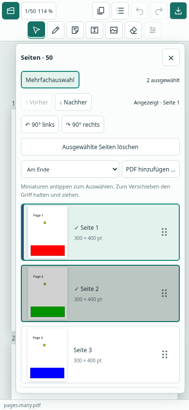
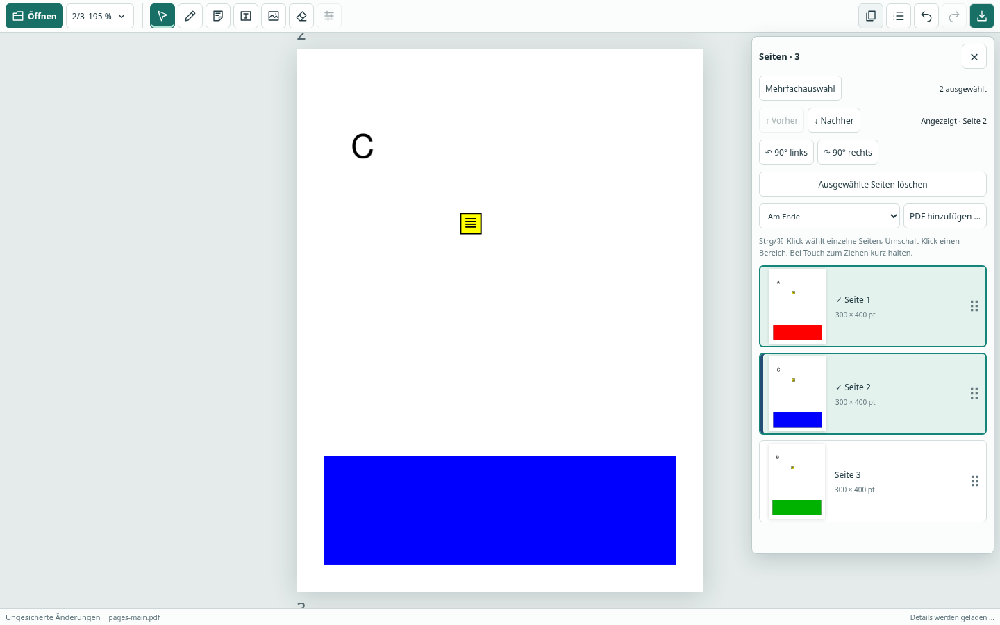
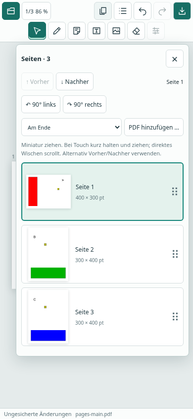

# PDF-Seiten auswählen, verschieben und löschen

Das **Seitensymbol** in der Hauptleiste öffnet die Seitenübersicht als überlagertes Menü. Die PDF-Arbeitsfläche bleibt bei geschlossenem Menü unverändert groß.

- Ein Klick auf eine Miniatur wählt diese Seite aus und zeigt sie an. **Strg + Klick** (macOS **Cmd + Klick**) fügt einzelne Seiten hinzu oder entfernt sie. **Umschalt + Klick** markiert den Bereich ab der zuletzt angeklickten Seite. Die Hauptansicht bleibt bei diesen Mehrfachauswahlen auf der angezeigten Seite.
- **Mehrfachauswahl** aktiviert auf Touchgeräten die Auswahl durch Antippen. Erneutes Antippen entfernt die Seite. Wischen über eine Miniatur scrollt die Liste. Ein Häkchen und eine grüne Fläche markieren ausgewählte Seiten. Ein blauer Rand und die Angabe **Angezeigt** kennzeichnen die aktuelle Seite. Oben steht die Anzahl der ausgewählten Seiten.
- Eine markierte Miniatur mit der Maus zur Einfügelinie ziehen. Auf Touchgeräten eine Miniatur etwa **0,4 Sekunden** halten und ziehen, im Auswahlmodus dazu den **Griff rechts** verwenden. Am Listenrand scrollt die Liste beim Ziehen automatisch. Escape, Abbruch der Berührung und Fokusverlust brechen die Geste ab.
- Die Auswahl wird in ihrer bisherigen Dokumentreihenfolge als zusammenhängende Gruppe eingefügt. Eine unmarkierte Miniatur lässt sich einzeln ziehen. **Vorher / Nachher** verschieben dieselbe Auswahl per Schaltfläche oder Tastatur. Bei verstreuten Seiten orientiert sich **Vorher** an der ersten und **Nachher** an der letzten ausgewählten Seite.
- **Ausgewählte Seiten löschen** zeigt die Anzahl vor der Bestätigung an. **Abbrechen** verwirft den Auftrag. Mindestens eine Seite muss im Dokument verbleiben. Nach dem Verschieben oder Löschen bleibt die angezeigte Seite aktiv, sofern sie erhalten bleibt. Sonst wird die nächste verbleibende Seite angezeigt, am Dokumentende die vorherige.
- **↶ 90° links / ↷ 90° rechts** dreht die aktuelle Seite. Miniatur und Hauptansicht werden aktualisiert und die Seite wird neu eingepasst. Die Drehung bleibt beim PDF-Export erhalten. Vier Drehungen ergeben wieder die ursprüngliche Ausrichtung.
- **PDF hinzufügen …** fügt alle Seiten einer ausgewählten PDF **am Ende** oder **nach der aktuellen Seite** ein. Anschließend wird die erste hinzugefügte Seite angezeigt. Mehrere Dateien können nacheinander hinzugefügt werden.
- Jede Gruppenverschiebung, Löschung, Drehung und jeder Import ist ein einzelner **Rückgängig-/Wiederholen**-Schritt. Offene Änderungen im Eigenschaftenformular müssen zuerst übernommen oder verworfen werden. Bei identischer Seitenreihenfolge entsteht kein Journal-Eintrag.
- **PDF herunterladen** exportiert die verbleibenden Seiten in der angezeigten Reihenfolge einschließlich importierter Seiten. Originaldateien werden nicht verändert. Ohne Export gehen Änderungen beim Schließen verloren.

## Erhalt der PDF-Objekte

Beim Umsortieren werden die Einträge im nativen PDF-Seitenbaum versetzt. Der Dokumentkatalog bleibt erhalten. Beim Wechsel zwischen Baumzweigen übernimmt die Seite ihre wirksamen Ressourcen, Seitenrahmen und Drehung. Drehungen ändern ausschließlich den nativen `/Rotate`-Wert der ausgewählten Seite und überschreiben dabei gegebenenfalls einen geerbten Wert. Seiteninhalt, CropBox und Annotationsdictionarys bleiben beim Drehen unverändert. PDF-Anzeigen berücksichtigen weiterhin die vorhandenen Annotationsflags (z. B. `NoRotate` für aufrechte Notizsymbole). Beim Import wird eine fehlende Quelldrehung explizit als 0° übernommen, damit sie keine Drehung vom Seitenbaum des Zieldokuments erbt. Der Import überträgt native Seitenobjekte und deren Ressourcen, Annotationen und Appearance-Streams mit einer gemeinsamen MuPDF-GraftMap. Kein Rastern oder Flattening. Nicht unterstützte Annotationen bleiben erhalten. Popup-/Antwortbeziehungen und interne Seitenverweise werden mitkopiert. Benannte interne Ziele der Quelldatei werden vor dem Kopieren zu expliziten Seitenzielen aufgelöst, damit gleiche Zielnamen unterschiedlicher PDFs nicht kollidieren. Importierte Lesezeichen werden unter dem Quelldateinamen zusammengefasst. Vorhandene explizite Seitenbeschriftungen bleiben den physischen Seiten zugeordnet; die Oberfläche zeigt Positionen ab 1.

Das Undo-Journal und der Export-Replay enthalten Seitenoperationen gemeinsam mit Annotationsänderungen. Importierte Annotations-IDs werden beim Export neu zugeordnet. Die Seitenauswahl verwendet die nativen Objekt-IDs des geöffneten Dokuments. Sie bleibt beim Umordnen und Scrollen erhalten. Beim Öffnen einer anderen PDF beginnt die Auswahl neu. Rastercache, Auswahl und laufende Annotationsgesten werden nach Strukturänderungen erneuert. Nur sichtbare Miniaturen und wenige benachbarte werden gerendert; die beim Ziehen erfasste Zeile bleibt bis zum Loslassen erhalten.

## Verweise beim Löschen

Vor dem ersten Schreibzugriff prüft der Editor die Verweise aus dem verbleibenden Dokument. Interne Links, Lesezeichen, Startansicht und benannte Ziele auf eine gelöschte Seite wechseln zur nächsten erhaltenen Seite in der ursprünglichen Reihenfolge. Gibt es rechts davon keine Seite mehr, gilt die letzte erhaltene Seite. Zoom und Ausschnitt des Ziels bleiben erhalten. Die Zielkorrekturen, Seitenbeschriftungen und Löschungen bilden einen gemeinsamen Undo-/Redo-Schritt.

Ein Verweis auf einen gelöschten Kommentar oder ein unbekannter Objektverweis auf eine zu löschende Seite verhindert die gesamte Löschung. Das betrifft beispielsweise eine Antwort, die auf einer verbleibenden Seite steht. Numerische lokale Seitenziele, verschachtelte Verweise auf eingebettete PDFs, PDF-JavaScript-Aktionen, feste Druckseitenbereiche und zu komplexe Verweisstrukturen können das Verschieben oder Löschen ebenfalls verhindern. Die Oberfläche zeigt den Grund an. Solche Prüfungsfehler erhalten auch einen vorhandenen Wiederholen-Zweig. Tritt erst beim nativen Schreiben ein unerwarteter Fehler auf, setzt MuPDF das Dokument zurück. MuPDF 1.28.6 kann bei diesem Abbruch einen zuvor vorhandenen Wiederholen-Zweig verwerfen.

Beim Export mit einer aktiven Löschung schreibt MuPDF eine neue Datei und entfernt unerreichbare Objekte und frühere Dateirevisionen. Gemeinsam genutzte Ressourcen bleiben für die übrigen Seiten verfügbar. Ohne aktive Löschung verwendet der Export weiterhin das inkrementelle Speicherverfahren.

## Grenzen dieser Version

- Der Import übernimmt jeweils eine ganze PDF. Die Auswahl einzelner Importseiten und das Duplizieren von Seiten sind noch offen.
- Seitenbearbeitung ist für Formulardokumente und strukturierte/tagged PDFs deaktiviert. Die normale Anzeige bleibt verfügbar. Signatur-/Verschlüsselungs-/Schreibschutzregeln gelten weiterhin.
- Als **Importquelle** werden außerdem PDFs mit Ebenen, dokumentweiten OutputIntents/Farbprofilen, dokumentweiten Dateianhängen oder zusätzlichen Namensverzeichnissen außer Seitenzielen abgewiesen. Diese Dokumentstrukturen können noch nicht sicher zusammengeführt werden. Auch beschädigte/geschützte Quellen und nicht auflösbare interne Ziele werden abgewiesen. Die Ziel-PDF und ihre bisherige Historie bleiben bei der Prüfung unverändert.
- Titel, Autor und andere dokumentweite Metadaten der zusätzlichen Datei werden nicht als neue Metadaten des Gesamtdokuments übernommen. Die Metadaten des Ausgangsdokuments bleiben bestehen. Dokumentaktionen werden nicht ausgeführt; die Anwendung aktiviert kein PDF-JavaScript.
- Maximal 100 MB pro Quelldatei, insgesamt 150 MB aktive Quelldateien und 2000 Seiten; Export maximal 150 MB. Weitere bestehende Seiten-/Rasterlimits gelten weiter. GraftMap, Journal und Export-Replay benötigen zusätzlichen Speicher; diese Grenzen sind keine feste RAM-Obergrenze. Beim Export werden Quelldateien erneut verarbeitet. Für sehr große Dateien sind Laufzeit und Speicher weiter zu untersuchen.
- Tests verwenden synthetische PDFs. Touch ist Chromium-Emulation, kein Test auf einem physischen Telefon. Acrobat/PDF Expert und native Desktop-Bedienung wurden für diesen Schritt nicht interaktiv geprüft. Desktop-Pakete bleiben unsignierte Testversionen.

## Automatisierte Prüfung

Alle Prüfdokumente sind synthetisch.

- `npm test` erzeugt die Basis-PDF und führt die Unit-Tests aus. `tests/pages.test.ts` prüft Einfügepositionen, stabile Blattobjekte in verschachtelten Seitenbäumen, übernommene Seitengrößen und Drehungen, Import, native Annotationen, Popup-/Antwortbeziehungen und Seitenbeschriftungen. Tests für Startansicht, benannte und explizite Ziele und Lesezeichen prüfen Umsortieren, Löschen, Undo/Redo und Wiederöffnen. Fehlerfälle umfassen sämtliche Seiten, Schreibschutz, Formulare, strukturierte Dokumente und einen simulierten Fehler nach der ersten nativen Löschung.
- `npm run test:e2e -- tests/e2e/pages.spec.ts` prüft Klick, Strg/Cmd, Umschaltbereich, Touch-Auswahl, Wischen, Langdruck, Tastaturverschiebung, Bestätigung und Abbruch, Import, Rotation, Undo/Redo, Export sowie den Dokumentwechsel. Beim Ziehen über 50 Seiten prüft der Test die Gruppe am Listenende im exportierten PDF.
- `npm run typecheck`, `npm run lint` und `npm run build` prüfen Typen, statische Regeln und den Produktionsbuild. Der Pull Request dokumentiert die tatsächlich ausgeführten Läufe und die unabhängige Prüfung des Lösch-Exports mit Poppler.

Bei Einführung der Gruppenbearbeitung bestanden lokal alle 176 Unit-Tests und alle 98 Chromium-End-to-End-Tests. Poppler las im Lösch-Export zwei Seiten mit den erwarteten Texten B und E.

GitHub Actions führt diese Abläufe in Chromium und die Maus-/Tastaturabläufe zusätzlich in Firefox aus. Tatsächliche abschließende Testzahlen und CI-Links stehen im Pull Request. Die bestehende Pages-Vorschau zeigt diese Änderungen erst nach einem Merge; der PR veröffentlicht nichts. Der Actions-Lauf liefert Build, Testberichte und synthetische Prüfdateien als Artefakt.

